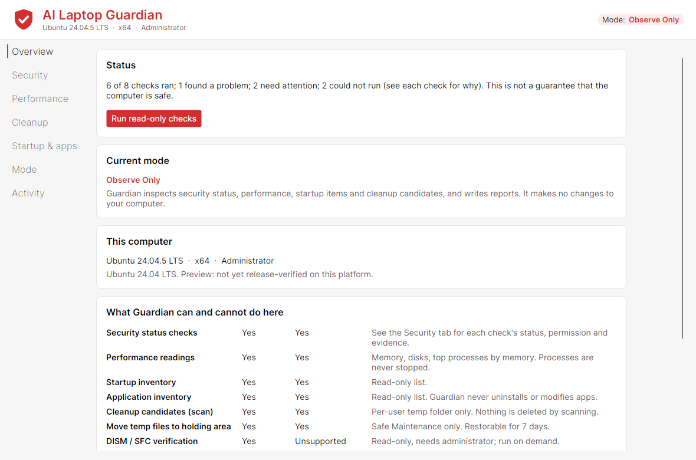

<p align="center"></p>

# AI Laptop Guardian

A cross-platform desktop security and maintenance assistant for Windows, macOS and Linux that puts your
existing software and personal data first. It **starts in Observe Only mode** and changes nothing until you
explicitly turn on a maintenance mode.

> **Status: 0.1 preview.** No platform is declared supported yet. Read
> [docs/PLATFORM_STATUS.md](docs/PLATFORM_STATUS.md) before installing anywhere that matters.



## What it does

| Mode | What Guardian may do | How you enable it |
|---|---|---|
| **A · Observe Only** (default) | Read security status, performance, startup items, installed apps; list cleanup candidates; write reports. **No changes.** | Default after install |
| **B · Safe Maintenance** | Move temp files you select, that pass every safeguard, into Guardian's own holding area (restorable for 7 days). Schedule a daily Microsoft Defender scan (default 07:30) and start scans; Defender removes what it finds. | Type `ENABLE SAFE MAINTENANCE` |
| **C · Controlled Repair** | Run a specific repair (for example Windows DISM/SFC) only after you approve that exact operation. | Type `ENABLE CONTROLLED REPAIR`, then approve each repair |

Every check shows whether it is implemented, supported on this OS, permitted, whether it actually ran, the
evidence it used, what changed, whether it succeeded, and any follow-up. Guardian never says a computer is
"virus-free" or "fully optimized"; a test enforces that.

## Things Guardian will never do on its own

Uninstall or modify other apps · delete app or personal files · touch browser profiles, passwords or cookies ·
edit the registry, system config or environment variables · disable antivirus, firewalls or updates · kill a
process for using CPU or memory · quarantine a file because of its name, location or an AI guess · registry
cleaning, driver removal or "optimization" · any repair whose consequences are unknown.
See [docs/SAFETY_POLICY.md](docs/SAFETY_POLICY.md) for how each rule is enforced in code.

## Layout

```
src/Guardian.Core              Shared logic: modes, operation gate, reporting, cleanup safeguards, holding area, repair plans
src/Guardian.Data              SQLite store: mode + consent history, operation log, check history
src/Guardian.Platform.Windows  Defender, Security Center, Firewall, updates, restart, UAC, BitLocker, DISM/SFC (verify), Task Scheduler
src/Guardian.Platform.MacOS    Gatekeeper, SIP, XProtect, firewall, FileVault, softwareupdate, launchd
src/Guardian.Platform.Linux    Ubuntu/Debian (apt) and Fedora (dnf): firewall, updates, auto-updates, restart, AppArmor/SELinux, LUKS, ClamAV, systemd timers
src/Guardian.App               Avalonia UI + "--report" command-line mode
tests/                         Unit, platform-parser, database, headless UI and non-interference tests
packaging/                     .deb, .rpm spec, WiX MSI, macOS .app/.pkg
```

## Build and run

Requires the .NET 10 SDK.

```bash
dotnet test                                                # all tests
dotnet run --project src/Guardian.App                      # desktop app
dotnet run --project src/Guardian.App -- --report          # read-only report in the terminal (add --json for JSON)
```

Packaging and uninstalling: [docs/INSTALL.md](docs/INSTALL.md). Recovery: [docs/RECOVERY.md](docs/RECOVERY.md).
Privacy: [docs/PRIVACY.md](docs/PRIVACY.md). Limitations: [docs/KNOWN_LIMITATIONS.md](docs/KNOWN_LIMITATIONS.md).
Dependencies and licences: [docs/DEPENDENCIES.md](docs/DEPENDENCIES.md). Testing plan: [docs/TESTING.md](docs/TESTING.md).
